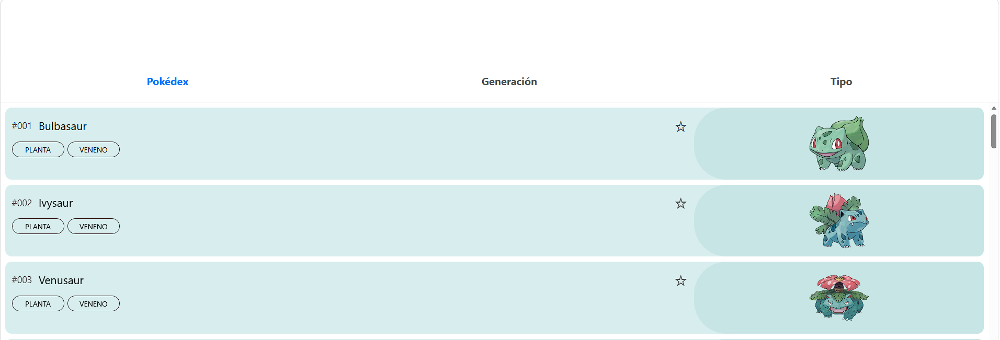
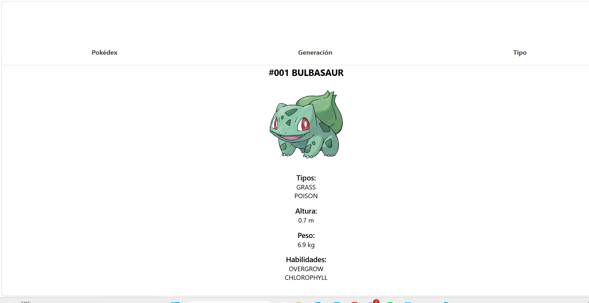

# 📋 Reparto de tareas

---

## 🖥️ Vista 1: Vista principal

Incluye a los pokemones de manera ascendente en lista y la la parte de arriba la barra de navegación

Para sacar la información y las imágenes de cada pokemon se utilizará la poke Api

🔗 **Link:** [https://pokeapi.co/](https://pokeapi.co/)

---

## 🔍 Vista 2: Información detallada cada pokemon

Se agregará los poderes, movimientos y características de cada pokemon

---

## 🧭 Vista 3: Barra de navegación

| Opción | Acción |
|---|---|
| **Pokedex** | Cuando se haga click regrese a vista 1 el listado de todas los pokemones |
| **Generacion** | Cuando se haga clik saque una tarjeta donde vengan todas las generaciones y se elija una de ellas y luego se haga el listado de todos los pokemones de esa generación |
| **Tipo** | Cuando se haga clik saque una tarjeta donde vengan todos los tipos y se elija una de ellas y luego se haga el listado de todos los pokemones de ese tipo |

---

## 📝 Notas

- Se utilizará reactive paper para hacer el diseño de las vistas
- Sugerencias todas bienvenidas
- **Rubrica:** [GitHub - luzaracelydls/pia-moviles](https://github.com/luzaracelydls/pia-moviles)

## AVANZES

-Se termino la barra de vagacion se puede escoger por generacion y tipo

## Terminar

- Falta enlazar la API de pokemon com la vista 1
- Agregar lso gritos de cada pokemon "cries". La api tiene esa función
- Terminar las cartas detalladas de cada pokemon

## Posibles Cosas que podemos agregar

- Lista de objetos
- minijuegos ?
- poder buscar el nombre de un Pokémon